<h1 align="center">Hi, I'm Ross Bratton 👋</h1>

  Software developer working mainly with <b>C# / .NET</b> and <b>TypeScript</b>, building APIs, web apps and cloud tooling on <b>AWS</b> and <b>Azure</b>.

---

### 🛠️ Tech Stack

  

### 📊 GitHub Stats

  <a href="https://github.com/TheProdigy161">
    <picture>
      <source media="(prefers-color-scheme: dark)" srcset="./profile/stats-dark.svg" />
      
    </picture>
  </a>
  <a href="https://github.com/TheProdigy161?tab=repositories">
    <picture>
      <source media="(prefers-color-scheme: dark)" srcset="./profile/top-langs-dark.svg" />
      
    </picture>
  </a>

### 📌 Featured Projects

  <a href="https://github.com/TheProdigy161/manga-api">
    <picture>
      <source media="(prefers-color-scheme: dark)" srcset="./profile/pin-manga-api-dark.svg" />
      
    </picture>
  </a>
  <a href="https://github.com/TheProdigy161/manga-frontend">
    <picture>
      <source media="(prefers-color-scheme: dark)" srcset="./profile/pin-manga-frontend-dark.svg" />
      
    </picture>
  </a>
  <a href="https://github.com/TheProdigy161/aws-s3-file-validator">
    <picture>
      <source media="(prefers-color-scheme: dark)" srcset="./profile/pin-aws-s3-file-validator-dark.svg" />
      
    </picture>
  </a>
  <a href="https://github.com/TheProdigy161/gitpruned">
    <picture>
      <source media="(prefers-color-scheme: dark)" srcset="./profile/pin-gitpruned-dark.svg" />
      
    </picture>
  </a>

---

  Stats generated daily by <a href="https://github.com/stats-organization/github-readme-stats-action">GitHub Readme Stats Action</a>

